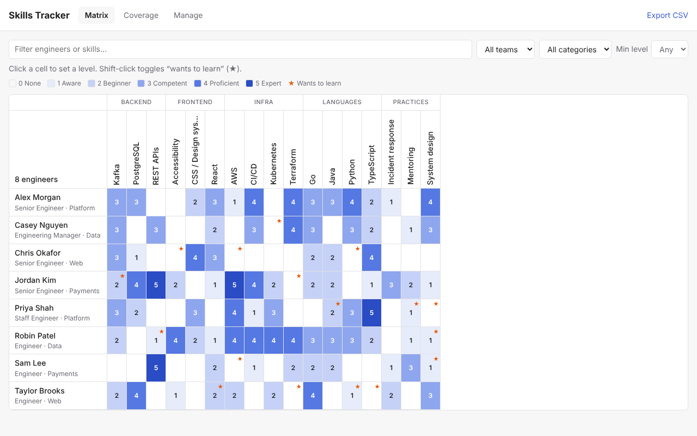

# Skills Tracker

A small web app for tracking skills across the engineers in a department: who knows what, how well, who wants to learn what, and where the knowledge gaps are.



## Features

- **Matrix** — engineers × skills grid, grouped by category. Click a cell to set a level (0–5); shift-click to flag "wants to learn" (★). Filter by name, team, category, and minimum level (e.g. type `kube` + `3+` to find everyone competent in Kubernetes).
- **Coverage** — per-skill bus factor (engineers at level 3+), expert count, average level and learning interest, sorted so your riskiest skills are at the top.
- **Manage** — add, rename and delete engineers (name / team / role) and skills (name / category).
- **Export CSV** — the whole matrix as a spreadsheet.

### Level scale

| Level | Meaning |
|---|---|
| 0 | None |
| 1 | Aware — knows what it is |
| 2 | Beginner — can work on it with help |
| 3 | Competent — works independently |
| 4 | Proficient — go-to person, reviews others' work |
| 5 | Expert — could teach it / set direction |

## Running it

Requires Node.js 22.13 or newer. There are no dependencies to install (it uses Node's built-in SQLite).

```bash
npm start          # http://localhost:3000
npm run seed       # optional: load sample data into an empty database
npm test
```

Configuration via environment variables:

- `PORT` — port to listen on (default `3000`)
- `DB_FILE` — SQLite database path (default `skills.db`)

## Before rolling it out

- **There is no login.** Anyone who can reach the server can edit anything. Run it on an internal network / behind your SSO proxy, or add auth before exposing it.
- **Back up `skills.db`** — it's the only copy of your data.

## Project layout

```
server.js        HTTP server, JSON API and static file serving
db.js            SQLite schema and queries
seed.js          Sample data
public/          Frontend (plain HTML/CSS/JS, no build step)
test/            API tests (node:test)
```
